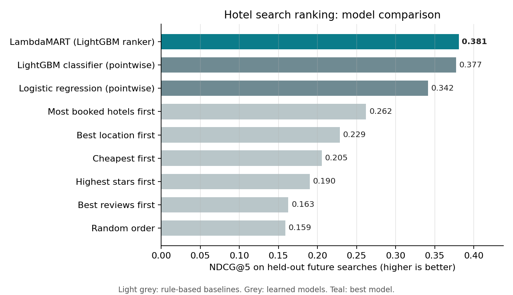
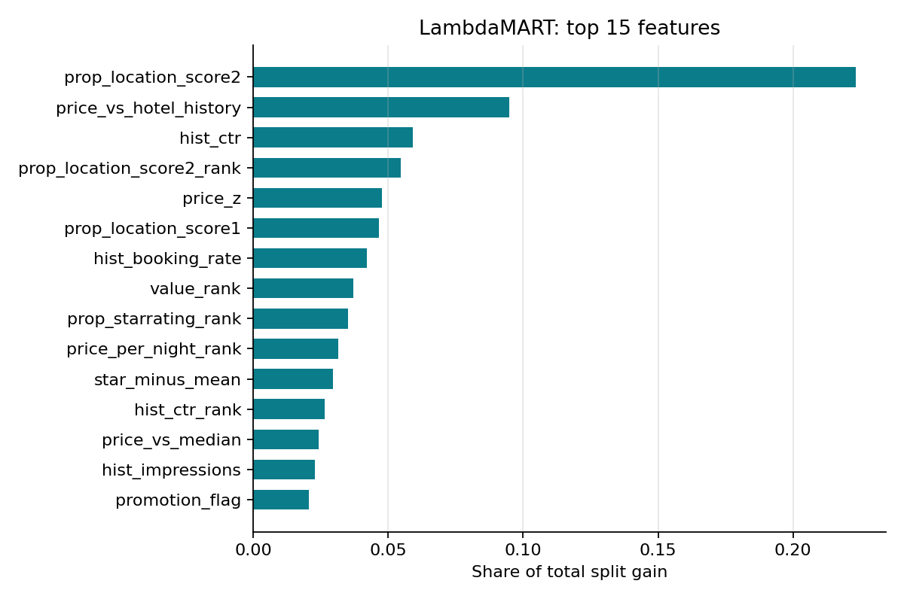

# Hotel Search Ranking with Learning to Rank

[](https://colab.research.google.com/github/gyanasaiadusumilli/hotel-search-ranking/blob/main/notebooks/train_on_colab.ipynb)

Ranking hotels in search results so that the ones a traveller will click and book appear at the top. Uses ~400,000 real hotel searches from Expedia and compares rule-based rankings, pointwise models and a **LambdaMART** learning-to-rank model, evaluated with **NDCG** and an **offline A/B test**.

> I worked on hotel ranking with the Ranking and Optimization team during my internship at OYO. That data is private, so this project rebuilds the same kind of system on public data.

## Problem

A traveller searches for a destination and dates and sees a list of up to 38 hotels. The order matters: most clicks go to the first few results. The task is to order each results list so that booked and clicked hotels rank as high as possible.

## Data

[Expedia Personalized Hotel Search](https://www.kaggle.com/competitions/expedia-personalized-sort) (Kaggle, 2013): about 10 million rows, one per hotel shown in a search. Each row has hotel attributes (stars, review score, location scores, price), search details (length of stay, booking window, party size), visitor history, competitor prices, and the outcome (clicked, booked).

**Relevance label per hotel:** 5 = booked, 1 = clicked but not booked, 0 = neither.

About 30% of searches showed hotels in **random order** instead of Expedia's ranking. Those searches are free of position bias, so results are also reported on them separately.

## Approach

**Time-based split.** Searches are sorted by date: the oldest 70% train the models, the next 10% are for early stopping, and the newest 20% are the test set. This mimics production, where a model trained on the past ranks future searches.

**Features (about 45)**

| Group | Examples |
|---|---|
| Hotel | star rating, review score, location scores, brand, promotion flag, historical price |
| Search | length of stay, booking window, adults, children, rooms, Saturday night stay |
| Within-search (relative) | price rank and z-score within the results list, price vs. the list median, star and review rank, a value-for-money score |
| Visitor fit | difference between the hotel and the visitor's past star rating and spend |
| Competitors | how many competitors are cheaper or more expensive, mean price difference |
| Hotel popularity | historical click and booking rate per hotel, **out-of-fold target encoding** on training searches only, so no row sees its own label |

Columns only known after the search (`position`, `click_bool`, `booking_bool`, `gross_bookings_usd`) are never used as features.

**Models**

| Type | Model |
|---|---|
| Rule-based baselines | random order, cheapest first, highest stars, best reviews, best location, most-booked hotels first |
| Pointwise | logistic regression, LightGBM classifier (predicts click or booking per hotel) |
| Listwise learning to rank | **LambdaMART** (LightGBM `lambdarank`), which optimizes NDCG directly by comparing hotels within each search |
| Reference | Expedia's own production ranking (the order hotels were actually shown in) |

**Evaluation**

- **NDCG@5, NDCG@10, NDCG@38** (gain 2^relevance − 1). NDCG@38 covers the full list and was the competition metric.
- **Booked in top 5:** for searches that ended in a booking, how often the booked hotel was in the top 5.
- **Offline A/B test:** a paired bootstrap over test searches (2,000 resamples) gives the NDCG@5 difference between two rankers with a 95% confidence interval and p-value. Each search is scored by both rankers, which is how an online A/B test is usually approximated before launch.

## Results

Half of the searches were used (`--frac 0.5`): **139,518 training searches** (Nov 2012 – Apr 2013), 19,931 for validation and **39,862 test searches** from the following weeks (May 21 – Jun 30, 2013). 44 features; LambdaMART stopped at 494 trees.



| Ranker | NDCG@5 | NDCG@10 | NDCG@38 | Booked hotel in top 5 |
|---|---|---|---|---|
| Random order | 0.159 | 0.230 | 0.351 | 26.6% |
| Best reviews first | 0.163 | 0.237 | 0.354 | 28.4% |
| Highest stars first | 0.190 | 0.266 | 0.374 | 32.0% |
| Cheapest first | 0.205 | 0.277 | 0.384 | 33.1% |
| Best location first | 0.229 | 0.299 | 0.400 | 37.5% |
| Most booked hotels first | 0.262 | 0.331 | 0.423 | 42.4% |
| Logistic regression (pointwise) | 0.342 | 0.409 | 0.478 | 54.2% |
| LightGBM classifier (pointwise) | 0.377 | 0.443 | 0.504 | 58.7% |
| **LambdaMART** | **0.381** | **0.446** | **0.506** | **58.8%** |

Full results, including the random-order and Expedia-ordered subsets, are in [`results/comparison.md`](results/comparison.md).

### Offline A/B tests (NDCG@5, paired bootstrap over test searches)

| Comparison | Difference | 95% CI | p-value |
|---|---|---|---|
| LambdaMART vs. most-booked-first rule | **+0.119 (+45%)** | +0.115 to +0.122 | < 0.001 |
| LambdaMART vs. pointwise LightGBM | **+0.003 (+0.9%)** | +0.001 to +0.005 | 0.001 |
| LambdaMART vs. Expedia's own ranking (27,954 searches) | −0.001 (−0.2%) | −0.006 to +0.004 | 0.69 (no significant difference) |

### What the results show

- **Learning to rank beats every rule.** LambdaMART puts the booked hotel in the top 5 for 58.8% of booking searches, against 42.4% for the best rule (most-booked hotels first) and 26.6% for random order.
- **Listwise beats pointwise, but only slightly.** Optimizing NDCG directly gives a small (+0.9%) but statistically significant gain over a classifier trained on the same features. Most of the gain comes from the features, not the loss function.
- **It matches Expedia's production ranking.** On searches Expedia ranked itself, there is no significant difference between LambdaMART and Expedia's order (p = 0.69). This comparison favours Expedia: clicks are biased toward the positions Expedia chose.
- **Holding up without position bias.** On the random-order searches, where position bias is absent, LambdaMART is still the best model (NDCG@5 0.332 vs. 0.326 pointwise and 0.238 for the best rule).
- **What drives bookings:** the hotel's location desirability score, whether today's price is below the hotel's usual price, and the hotel's historical click rate are the top three features. Relative features (price z-score and rank within the results list) outrank raw price.



These are single runs with one seed on half of the data.

## Project structure

```
hotel-search-ranking/
├── notebooks/
│   └── train_on_colab.ipynb   # One-click download, train and evaluate
├── scripts/
│   └── make_synthetic.py      # Small fake dataset with the same columns, for testing the code
├── src/
│   ├── data.py                # Loading, relevance labels, time-based split
│   ├── features.py            # Feature engineering and target encoding
│   ├── metrics.py             # NDCG, booked-in-top-k, paired bootstrap A/B test
│   └── run.py                 # Baselines, models, evaluation and plots
└── requirements.txt
```

## How to run

**Easiest: Google Colab.** Click the badge above and run all cells. You need a free Kaggle account and must accept the competition rules once (the notebook explains how).

**Locally:**

```bash
pip install -r requirements.txt
# Download train.csv from the Kaggle competition into data/
python -m src.run --data data/train.csv --frac 0.5    # use half of the searches

# Or test the pipeline in seconds on synthetic data:
python scripts/make_synthetic.py --out data/synthetic.csv
python -m src.run --data data/synthetic.csv --frac 1 --out results_synthetic
```

## Limitations

- In searches ranked by Expedia, clicks are biased toward the top positions, so models trained on those clicks partly learn Expedia's existing order. The random-order searches give an unbiased check.
- An offline A/B test on logged data approximates, but does not replace, a live experiment with real users.
